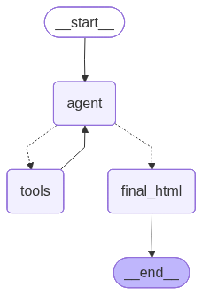

<div align="center">

# 🤖 AI Newsletter Agent

### *An Autonomous ReAct Agent that Researches and Writes High-Signal Tech Newsletters*

[](https://www.python.org/)
[](https://www.langchain.com/langgraph)
[](https://modelcontextprotocol.io/)
[](https://groq.com/)

**AI Newsletter Agent** is an autonomous AI workflow that dynamically queries real-time web sources to draft, format, and render a production-grade HTML tech newsletter. 

> **Note:** This is a practice project built specifically to explore and master **Advanced Agentic AI** concepts, including cyclic reasoning (ReAct), conditional routing, and the Model Context Protocol (MCP).

</div>

---

## 🌟 Features

### 🧠 **Autonomous ReAct Reasoning Loop**
Unlike static data pipelines, this agent thinks for itself. It analyzes the user request, decides which research tools to call, evaluates the returned data, and seamlessly recovers if a tool fails—looping continuously until it has enough context to write the draft.

### 🔌 **Decoupled MCP Architecture**
Data fetching is entirely decoupled from the LLM via a custom **FastMCP** server. The agent securely communicates with generic Python tools over `stdio`.
- **Arxiv Scraper:** Pulls the latest AI research papers.
- **GitHub Trending:** Gathers top AI repositories.
- **News Aggregator:** Fetches the top AI headlines of the week.
- **Product Hunt:** Captures trending AI tools.

### 📝 **High-Signal Output Formatting**
The agent operates under heavily constrained prompt engineering. It utilizes **Negative Constraints** (banned buzzwords) and **Few-Shot Examples** to strip out "AI-fluff" and output dense, opinionated, "so-what" focused tech journalism.

### 🎨 **Automated HTML Generation**
Once the LLM drafts the markdown, the graph routes the output to a custom Python parser that injects the content into a responsive, beautifully styled HTML email template.

---

## 🔄 The LangGraph Workflow

The core of this project is built on **LangGraph**, using a conditional router to simulate autonomous thought.

<div align="center">
  
</div>

1. **Agent Node:** The LLM evaluates the system prompt and conversation history.
2. **Router:** If the LLM requests data, it triggers a `tool_call`. If it outputs markdown, it routes to completion.
3. **Tool Node:** Executes the requested MCP functions (e.g., searching Arxiv) and sends the results back to the Agent.
4. **HTML Node:** Parses the final markdown draft into a structured HTML email.

---

## 🚀 Quick Start

### Installation

1. **Clone the repository**
```bash
git clone https://github.com/yourusername/AI-Newsletter.git
cd AI-Newsletter
```

2. **Install dependencies**
Ensure you have `uv` installed, or use standard pip targeting a virtual environment:
```bash
pip install -r requirements.txt
```

3. **Set up your environment variables**
Create a `.env` file in the root directory:
```text
GROQ_API_KEY=your_groq_api_key_here
PRODUCT_HUNT_TOKEN=your_product_hunt_token_here
NEWS_API_KEY=your_news_api_key_here
LANGCHAIN_TRACING_V2=true 
LANGCHAIN_API_KEY=your_langsmith_key_here
LANGCHAIN_ENDPOINT="https://api.smith.langchain.com"
LANGCHAIN_PROJECT="AI Newsletter Agent"
```

---

## 💻 Usage

To kick off the autonomous agent and generate this week's newsletter:

```bash
python state.py
```

1. The MCP server will automatically boot up in the background.
2. You can track the agent's reasoning loop and tool execution in your LangSmith dashboard.
3. Once completed, a new `.html` and `.md` file titled with today's date will appear in your output folders!

---

## 🛠️ Tech Stack

- **LangGraph**: Orchestrates the cyclic Agent workflow.
- **FastMCP**: Hosts the data-fetching tools securely.
- **Groq**: Provides lightning-fast LLM inference (`gpt-oss-120b`).
- **LangSmith**: Used for tracing the agent's internal thought process.

---

<div align="center">

**Made with ❤️ by Saish**

⭐ Star this repo if you find it useful!

</div>